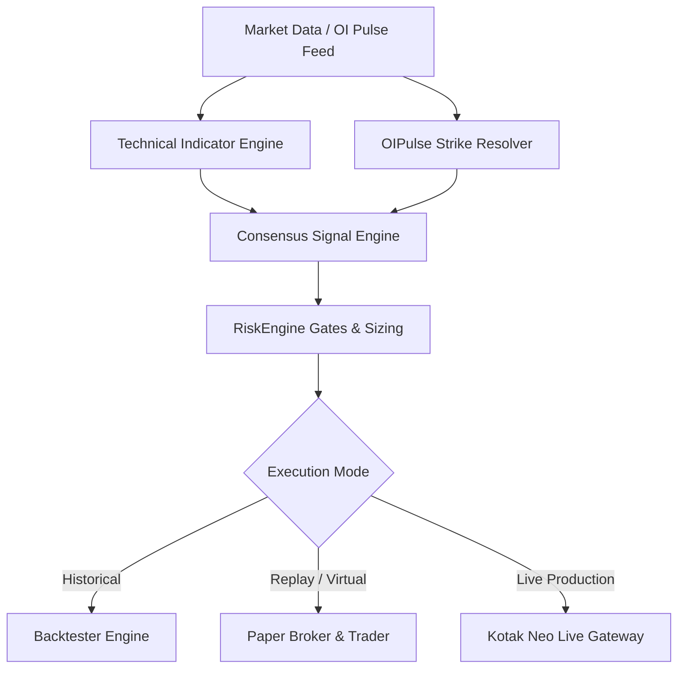

# AI Autotrading & Quantitative Backtesting Platform

A professional algorithmic intraday trading, paper-trading, and quantitative backtesting system designed for **Indian Equities & Derivatives (NSE F&O / Options)**. Features native **Kotak Neo API** integration, **Upstox V3 historical data loader**, **OIPulse Dynamic Options Trading Mode**, 14 modular technical indicators, multi-stage risk controls, and an interactive **Streamlit** multi-tab application suite.

---

## Table of Contents
1. [Platform Architecture & Modules](#platform-architecture--modules)
2. [OIPulse Dynamic Options Trading Mode](#oipulse-dynamic-options-trading-mode)
   - [Strike Bound Calculation](#1-strike-bound-calculation)
   - [Weekday Adjustments](#2-weekday-adjustments)
   - [OI Strength Signal Logic](#3-oi-strength-signal-logic)
   - [Tuesday Weekly Expiry Resolution](#4-tuesday-weekly-expiry-resolution)
   - [Black-Scholes Dynamic Option Pricing](#5-black-scholes-dynamic-option-pricing)
3. [Strategy Builder & Indicator Engine](#strategy-builder--indicator-engine)
4. [Risk Management System (`RiskEngine`)](#risk-management-system-riskengine)
5. [Execution Environments](#execution-environments)
   - [Backtesting Studio](#1-backtesting-studio)
   - [AI Paper Trading Studio](#2-ai-paper-trading-studio)
   - [Live Trading Terminal (Kotak Neo)](#3-live-trading-terminal-kotak-neo)
   - [Unified All-in-One Portal](#4-unified-all-in-one-portal)
6. [Scripts & Utility Tools Reference](#scripts--utility-tools-reference)
7. [Database Architecture & Audit Trails](#database-architecture--audit-trails)
8. [Installation & Quickstart](#installation--quickstart)
9. [Running Tests](#running-tests)

---

## Platform Architecture & Modules

The platform is designed around a modular event-driven architecture that separates data ingestion, indicator calculations, signal consensus, risk validation, and execution.



---

## OIPulse Dynamic Options Trading Mode

The **OIPulse Mode** enables automated options trading on major NSE indices (`NIFTY`, `BANKNIFTY`, `FINNIFTY`, `MIDCPNIFTY`) by combining real-time Open Interest (OI) Strength from OI Pulse with underlying technical indicator confirmation.

### 1. Strike Bound Calculation
The base strike bound is determined from the underlying Last Traded Price (LTP) according to each index's strike step:
- **NIFTY / FINNIFTY (50-point step):**
  $$\text{previous\_bound} = \left(\frac{\lfloor \text{LTP} \rfloor - 1}{50}\right) \times 50 + 1$$
- **BANKNIFTY (100-point step):**
  $$\text{previous\_bound} = \left(\frac{\lfloor \text{LTP} \rfloor - 1}{100}\right) \times 100 + 1$$
- **MIDCPNIFTY (25-point step):**
  $$\text{previous\_bound} = \left(\frac{\lfloor \text{LTP} \rfloor - 1}{25}\right) \times 25 + 1$$

### 2. Weekday Adjustments
Strike adjustments are applied dynamically based on the day of the week to align with weekly option volatility and decay profiles:

```python
adjustments = {
    "Wednesday": 350,
    "Thursday": 250,
    "Friday": 150,
    "Monday": 0,
    "Tuesday": -100
}
```

### 3. OI Strength Signal Logic
The option type and strike price are determined by the OI Strength reading:
- **Call Option (CE):** Triggered when $\text{OI Strength} > +50$:
  $$\text{Strike} = \text{previous\_bound} + \text{adjustment} - 1$$
- **Put Option (PE):** Triggered when $\text{OI Strength} < -50$:
  $$\text{Strike} = \text{previous\_bound} - \text{adjustment} - 1$$
- **Neutral Band ($-50 \le \text{OI Strength} \le +50$):** No trade signal (`HOLD`).

*Note:* In Option Buying mode, both CE and PE trades are entered as **`LONG`** positions in the respective option contract.

### 4. Tuesday Weekly Expiry Resolution
Weekly contracts dynamically resolve to the nearest upcoming **Tuesday weekly expiry**:
- Expiry date codes follow standard exchange conventions:
  - `01-SEP-2026` $\rightarrow$ `26S01` (e.g. `NIFTY26S0124000CE`)
  - `08-SEP-2026` $\rightarrow$ `26S08` (e.g. `NIFTY26S0824050PE`)
  - `15-SEP-2026` $\rightarrow$ `26S15` (e.g. `NIFTY26S1523500PE`)
  - `22-SEP-2026` $\rightarrow$ `26S22` (e.g. `NIFTY26S2223400PE`)
  - `29-SEP-2026` (Monthly Expiry) $\rightarrow$ `26SEP` (e.g. `NIFTY26SEP23400PE`)

### 5. Black-Scholes Dynamic Option Pricing
Option premiums are calculated dynamically using the Black-Scholes option pricing model with minute-level time-to-decay ($T = \frac{\text{minutes\_to\_expiry}}{365 \times 24 \times 60}$) and calibrated historical implied volatility ($\sigma = 16\%$), delivering realistic option premium pricing (~₹40 to ₹135).

---

## Strategy Builder & Indicator Engine

The platform includes **14 modular technical indicators** with customizable periods, thresholds, and consensus weights:

| # | Indicator | Bullish Condition (+Weight) | Bearish Condition (-Weight) |
| :- | :--- | :--- | :--- |
| 1 | **EMA Trend** | EMA Fast > EMA Slow | EMA Fast < EMA Slow |
| 2 | **VWAP** | Close > VWAP | Close < VWAP |
| 3 | **RSI** | 55 to 70 (Bullish Momentum) | 30 to 45 (Bearish Momentum) |
| 4 | **MACD** | Histogram > 0 | Histogram < 0 |
| 5 | **ADX** | ADX $\ge$ 20 and +DI > -DI | ADX $\ge$ 20 and -DI > +DI |
| 6 | **Volume Ratio** | Consecutive volume surge $\ge$ 1.2x | Consecutive volume surge $\ge$ 1.2x |
| 7 | **ATR** | Volatility expansion filter | Volatility expansion filter |
| 8 | **Bollinger Bands** | Mid < Close $\le$ Upper | Lower $\le$ Close < Mid |
| 9 | **Stochastic** | $20 \le \%K \le 80$ and $\%K > \%D$ | $20 \le \%K \le 80$ and $\%K < \%D$ |
| 10 | **OBV** | OBV > OBV MA | OBV < OBV MA |
| 11 | **Higher High (HH)** | Current High > Previous Swing High | — (Locks to LONG only) |
| 12 | **Lower Low (LL)** | — (Locks to SHORT only) | Current Low < Previous Swing Low |
| 13 | **Hull MA (HMA)** | HMA slope turning positive | HMA slope turning negative |
| 14 | **Supertrend** | Price above Supertrend band | Price below Supertrend band |

### Trade Exit Levels & Trailing Stop (Model B)
- **Fixed Targets & Stop Loss:** Configurable fixed target (e.g., +30%) and stop loss (e.g., -5%).
- **Trailing Stop-Loss (Model B):**
  - **Milestone 1 (Breakeven):** When price reaches 50% of the target, stop loss moves to entry price.
  - **Milestone 2 (Peak Trailing):** Trailing stop trails highest peak by the configured stop loss percentage.
  - **Trail Beyond Target:** Optional setting allowing the trade to bypass fixed targets and ride runaway trends.

---

## Risk Management System (`RiskEngine`)

Every order must pass strict pre-trade risk gates in [`app/risk/risk_engine.py`](file:///c:/AI%20Course/ai_autotrading_v1/app/risk/risk_engine.py):

1. **5-Minute Trade Snooze Cooldown (`snooze_minutes: 5`):**
   - After any position exit (Target, Stop, or Square-off), subsequent entries are strictly blocked for **5 minutes** to eliminate whipsaw and over-trading.
2. **Max Consecutive Losses (`max_consecutive_losses: 3`):**
   - Trading halts automatically for the day after 3 consecutive losing trades.
3. **Max Daily Loss Limit (`max_daily_loss: ₹2,000.0`):**
   - If cumulative daily net P&L reaches $-\text{₹}2,000$, trading is latched off for the rest of the day.
4. **Trading Hours Filter:**
   - New entries permitted strictly between **09:20 and 15:00 IST**.
5. **Intraday Auto Square-Off:**
   - All open positions are force-closed at **15:15 IST**.
6. **Position Sizing & Exposure Limits:**
   - Sizes orders based on capital risk budget (e.g., 1% per trade), maximum exposure cap (1.0 = 100%), and exchange lot sizes (65 for NIFTY).
7. **Directional Filter:**
   - Restricts trading to `LONG` only, `SHORT` only, or `BOTH`.

---

## Execution Environments

### 1. Backtesting Studio
- **File:** `app/ui/backtest_app.py`
- In-sample / Out-of-sample data splitting with visual timeline.
- Full performance reporting: Net P&L, Win Rate, Profit Factor, Max Drawdown, Expectancy, Total Costs.
- Persistent execution audit history stored in `data/backtest_runs.db`.

### 2. AI Paper Trading Studio
- **File:** `app/ui/paper_trade_app.py`
- Realistic market replay simulator with candle step, autoplay, and speed controls.
- Virtual portfolio broker with live margin tracking, slippage, and brokerage calculations.
- Historical trade journal with filters and CSV/JSON export.

### 3. Live Trading Terminal (Kotak Neo)
- **File:** `app/ui/live_trade_app.py`
- Live market execution using Kotak Neo API endpoints.
- Real-time 5-level market depth, live trailing stop updates, and emergency kill-switch.

### 4. Unified All-in-One Portal
- **File:** `main_app.py`
- Centralized multi-tab application hosting Backtesting, Paper Trading, Live Trading, and Strategy Builder.
- Secured with PBKDF2-HMAC-SHA256 user authentication (`data/users.db`).

---

## Scripts & Utility Tools Reference

| Script / Tool | Description |
| :--- | :--- |
| `main_app.py` | Unified Streamlit launcher for the entire trading platform. |
| `scripts/run_september_oipulse_backtest.py` | Standalone CLI runner for September master dataset backtest. |
| `scripts/schedule_oipulse_strength.py` | Live background scheduler attaching to Chrome to extract real-time OI Strength. |
| `scripts/extract_oipulse_trending_oi.py` | Historical data scraper for OI Pulse Trending OI table. |
| `scripts/load_oi_strength_to_db.py` | Ingests raw CSV data into `data/backtest.db` under the `oi_strength` table. |
| `launch_chrome_for_oipulse.bat` | Windows batch launcher for Google Chrome with remote debugging on port 9222. |
| `oipulse_logic.py` | Standalone reference script calculating strike and option type from LTP, weekday, and OI strength. |

---

## Database Architecture & Audit Trails

- **`data/backtest.db`**: Stores master `oi_strength` table containing 1-minute historical readings (`Date`, `Time`, `LTP`, `Strength`).
- **`data/backtest_runs.db`**: Stores execution runs (`backtest_runs`) and detailed trade logs (`backtest_trades`).
- **`data/paper_trading.db`**: Stores paper trading orders, positions, trades, and session events.
- **`data/live_trading.db`**: Stores live order books and execution audit logs.
- **`data/users.db`**: Stores encrypted user credentials for UI authentication.
- **`data/saved_strategies.json`**: Persistent JSON store for custom strategy configurations.

---

## Installation & Quickstart

### 1. Prerequisites
- Python 3.11+
- Windows PowerShell or Linux terminal

### 2. Virtual Environment Setup
```bash
python -m venv .venv
.\.venv\Scripts\Activate.ps1
pip install -r requirements.txt
```

### 3. Environment Variables
Copy `.env.example` to `.env` and configure your credentials:
```bash
cp .env.example .env
```
Key variables:
- `UPSTOX_ACCESS_TOKEN` (optional: for Upstox live/historical data)
- `KOTAK_CONSUMER_KEY`, `KOTAK_CONSUMER_SECRET`, `KOTAK_ACCESS_TOKEN` (optional: for Kotak Neo live execution)

### 4. Launching Applications

#### Launch Unified Application:
```bash
streamlit run main_app.py
```
*(Default login credentials: `admin` / `admin123`, or register a new user on the Sign Up tab).*

#### Launch Standalone Modules:
```bash
# Backtesting Studio
streamlit run app/ui/backtest_app.py --server.port 8501

# Paper Trading Studio
streamlit run app/ui/paper_trade_app.py --server.port 8502

# Live Trading Terminal
streamlit run app/ui/live_trade_app.py --server.port 8503
```

---

## Running Tests

Run the full automated test suite (200 tests covering risk rules, indicator math, OIPulse strike calculations, and UI backtesting):

```bash
python -m pytest tests/
```

Run specific test modules:
```bash
# OIPulse dynamic strike resolution and weekday adjustment tests
python -m pytest tests/test_oipulse_mode.py -v

# RiskEngine pre-trade rules and limit tests
python -m pytest tests/test_risk.py -v

# Full backtest simulation execution tests
python -m pytest tests/test_oipulse_backtest_execution.py -v
```
